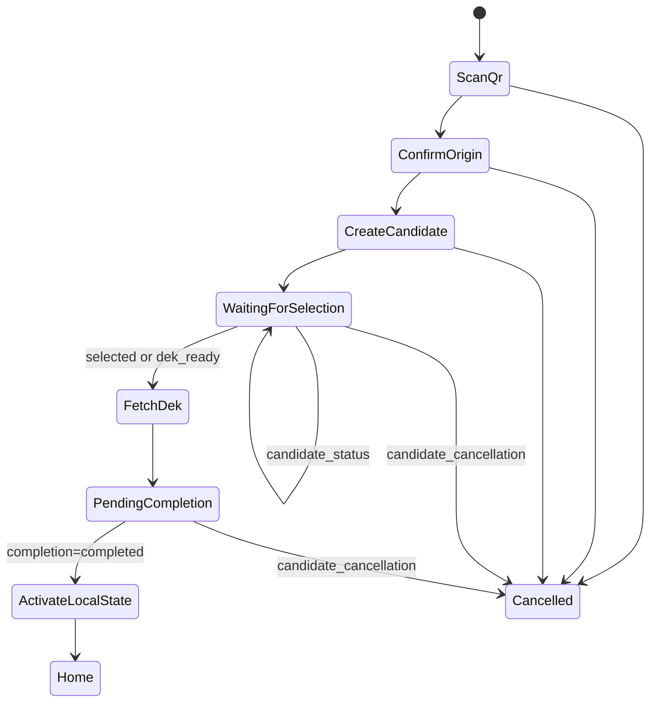

# First-Launch Recovery

Purpose: restore an existing account to a fresh, unregistered Android install
without creating a new account or asking the user to export a private key or
DEK.

Scope:
- The same recovery route is also available from authenticated Settings
  `Recovery Connection` for the current namespace server.
- With no `registration_state`, recovery creates a fresh candidate keypair and
  restores a full registration. With a stored registration, it reuses the
  existing keypair and mobile device ID.
- The normal `POST /api/v1/account` registration and the existing
  new-mobile-to-existing-account flow are not used.

## Navigation and UI

`RegistrationScreen` displays a `Recovery` action alongside the normal
registration actions. It navigates to a new `AppRoute.Recovery` destination in
`ZeroIntrusionAppRoot`, hosted by a dedicated `RecoveryScreen` and
`RecoveryViewModel`.

The recovery UI has these user-visible stages:

1. Scan the desktop's recovery QR code with the existing CameraX / ML Kit
   scanner.
2. Review and explicitly approve the QR's server origin.
3. Generate the candidate key and submit it; then display the 12-digit pairing
   code only after a `201` candidate response.
4. Wait for desktop selection, polling only while the screen is foregrounded.
5. Receive and decrypt the DEK, complete recovery, activate local state, then
   enter Home.
6. Offer cancellation before activation. Cancellation is confirmed in the
   recovery screen and never uses a Settings popup.

On process restart, a valid `recovery_pending_state` resumes this screen instead
of the initial registration form and refreshes its status immediately. Scanning
the same recovery QR resumes its candidate; scanning a different recovery QR
explicitly replaces the pending candidate after best-effort cancellation of the
old candidate.

## QR contract and transport policy

The accepted QR JSON is exactly:

```json
{
  "type": "recovery",
  "version": 1,
  "recoveryId": "uuid",
  "apiBaseUrl": "https://server.example"
}
```

Validation requirements:
- Reject malformed JSON, unknown type or version, invalid UUID, blank host,
  user-info, fragment, query, or unexpected path.
- The approved API origin is immutable for the current recovery; no redirect to
  another origin is followed.
- `https` is required in release builds.
- `http` is supported only for development builds. The runtime recovery URL
  validator permits it only when `BuildConfig.DEBUG` is true. The release
  manifest and release network-security configuration must not permit cleartext
  traffic.
- The current manifest has `android:usesCleartextTraffic="true"`; implementation
  must move this allowance to `src/debug` configuration before release.

## Candidate identity and cryptography

The candidate receives a fresh lowercase canonical UUID `candidateId`, a new
device ID matching `[A-Za-z0-9_-]{1,64}`, and the normal device name.

The implementation must generate a new 2048-4096-bit RSA Android Keystore key
pair for recovery. It cannot reuse a pre-existing candidate alias or silently
replace a registered device key. The candidate public key is canonical standard
Base64 SPKI DER. The private key remains non-exportable in Keystore.

The 12-digit pairing code is ASCII digits and treated as text so leading zeros
are retained. Its submitted `pairingCodeHash` is lowercase SHA-256 hex of this
exact compact UTF-8 JSON array, preserving order and without whitespace:

```json
["recovery-pairing-v1","<recoveryId>","<candidateId>","<mobileDeviceId>","<publicKey>","<pairingCode>"]
```

Every recovery request is signed through `SignatureService.signJsonString` with
the candidate Keystore key. The signature is Base64 RSA PKCS#1 v1.5 / SHA-1 over
the exact serialized request body. There is no additional signature envelope or
signature-algorithm upgrade.

## State machine



Terminal backend states (`delivery_failed`, `cancelled`, `revoked`, `expired`,
and `locked`) are errors, not successful completion. Expiry and terminal states
remove the pending data and candidate key after the user acknowledges the
result.

## Completion and full registration activation

`POST /recovery/candidate/dek` is the authority for the restored identity. It
returns `accountId`, `mobileDeviceId`, `email`, `phone`, `encDek`, and the full
namespace list. The status endpoint never returns this data.

Before completion, validate that the response IDs match the local candidate,
decrypt its `encDek` using RSA-OAEP SHA-1 / MGF1 SHA-1, and require a 32-byte
DEK. Persist the pending checkpoint before sending completion.

After `status=completed`:

1. Require exactly one returned namespace whose normalized `url` matches the
  QR-approved `apiBaseUrl`; this is the recovery root namespace.
2. Write `RegistrationState` from the account fields and root namespace,
   including `encDek`, email, phone, mobile device ID, and device name.
3. Import all returned namespaces into `ConnectedDevicesLocalStore` in the form
   consumed by `NamespacesRepository`. The root remains the current gateway;
   the additional namespaces become selectable account targets.
4. Delete `recovery_pending_state` only after the registration and namespace
   writes succeed.
5. Invoke existing FCM registration for the root namespace, then use
   `FcmTokenSynchronizer.syncNamespace` for other restored namespaces. FCM
   failure is visible and retryable but never rolls back a completed recovery.

This produces the same usable local account shape as a normal registration:
the user has an active `RegistrationState`, the candidate's Keystore key, the
encrypted DEK, account email and phone, a gateway namespace, and all returned
namespace connections.

For authenticated current-namespace recovery, the QR identifies the Recovery
Server and may use a different URL from the current gateway. Completion
verifies that the recovered account matches the stored account, leaves
`RegistrationState` unchanged, and upserts only the recovered namespace into
the mobile namespace list with `root = false`.
It never follows or imports additional returned namespace servers.

## Errors, retry, and cancellation

Map recovery errors by HTTP status: `400` input/code, `401` signature or nonce,
`403` non-selected candidate, `409` conflict/state, `410` expired or closed,
`429` rate limit with `Retry-After`, and `503` backend email/secret failure.

Each modifying request stores a generated `requestId` before network I/O. An
uncertain request can only be retried explicitly with the same request ID and
payload plus a fresh nonce. Polling, DEK fetch, and status calls do not have a
request ID. Do not log pairing codes, hashes, raw encrypted DEKs, decrypted
DEKs, complete bodies, or signatures.

## Implementation surfaces

- Add `AppRoute.Recovery`, the `NavHost` destination, and the registration
  screen action.
- Add `presentation/recovery`, `domain/recovery`, and
  `data/repository/recovery` packages rather than extending the authenticated
  settings recovery screen.
- Add recovery DTOs and `RecoveryApi` beside `RegistrationApi`; build each body
  explicitly before signing it.
- Extend the Keystore abstraction for a fresh candidate key lifecycle and add
  encrypted `RecoveryPendingStateStore` support.
- Update the API catalog, nonce matrix, and local-storage documentation with
  this feature.

## Verification

- Unit test QR parsing, release/debug URL policy, pairing-hash byte-for-byte
  output, request body ordering/signature input, response validation, and the
  full local activation transaction.
- Test explicit retries retain the original request ID and receive a fresh
  nonce.
- Test restart at each persisted stage, terminal states, cancellation, lost
  completion response, and FCM failure.
- Run `./gradlew :app:testDebugUnitTest` and `./gradlew :app:compileDebugKotlin`.